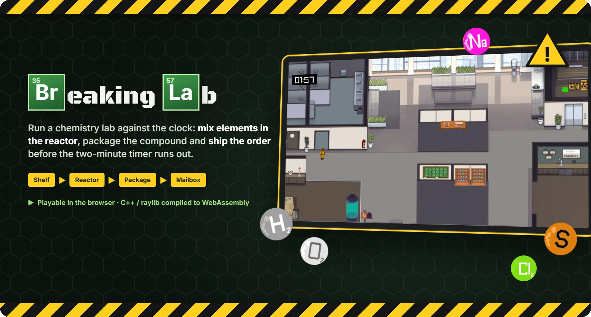
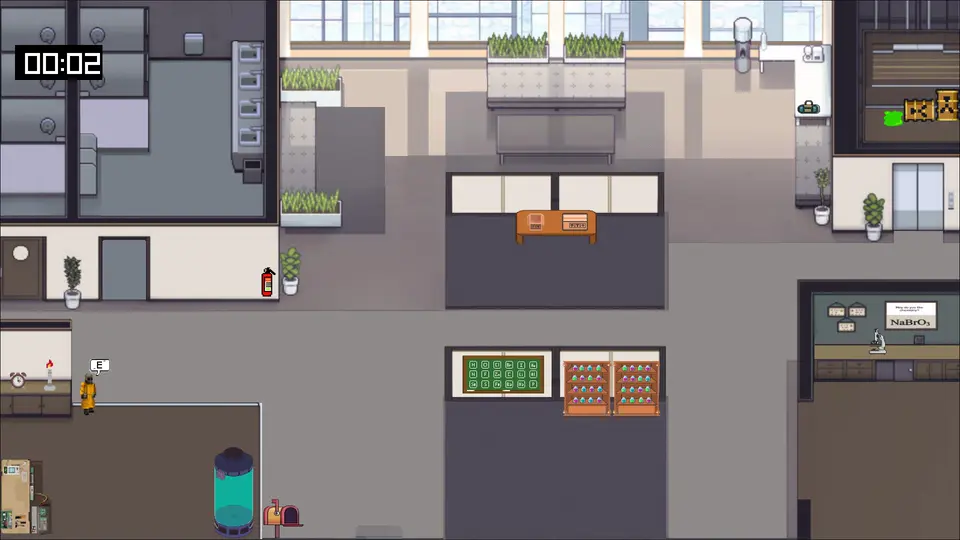
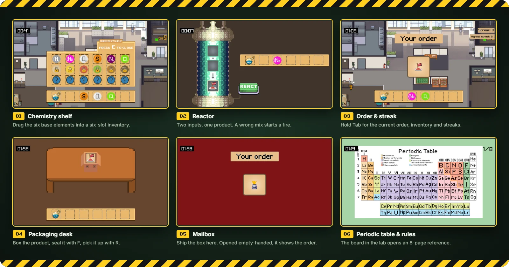
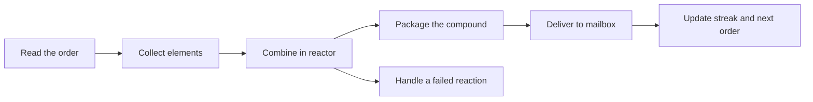

<div align="center">

# Breaking Lab

**Run the lab. Mix the order. Beat the clock.**

  

[**Play online →**](https://hhchandar20.github.io/BreakingLab/) · [Gameplay](#gameplay) · [Getting started](#getting-started) · [How it works](#how-it-works)



</div>

## Overview

Breaking Lab is a chemistry-themed time-management game. Collect elements from the shelf, combine them in the reactor, package the requested compound and deliver it to the mailbox. A countdown starts at **2:00**, and successful deliveries build your streak.

The lab is a walkable space with separate workstations, a fire extinguisher, instructions and a music player. A bad reaction can start a fire, turning a routine order into a scramble across the room.

## Features

| Work the order | Keep the lab running |
| --- | --- |
| **Element selection and reactor slots** for assembling compounds | **Fire and extinguisher interactions** when a reaction goes wrong |
| **Packaging and mailbox delivery** as separate steps | **Countdown and delivery streaks** displayed in the HUD |
| **Order and inventory panels** available while playing | **Music controls** for playback, track selection and repeat |

## Gameplay





Real game captures are presented with lab signage and element artwork from the project.

## Controls

| Context | Input | Action |
| --- | --- | --- |
| Movement | `W` `A` `S` `D` | Walk around the lab |
| Workstations | `E` | Interact with a nearby station |
| Extinguisher | Hold `E` while carrying it | Put out a fire |
| Order / inventory | Hold `Tab` | View the current order and inventory |
| Reactor | Mouse, `Space`, `R` | Select / place elements, activate the reactor, clear slots |
| Packaging | `F`, `R` | Seal or unseal; pick up the sealed package |
| Music player | `P`, `←` / `→`, `R`, `Q` | Pause; change track; toggle repeat; choose a random track |

Keys are context-sensitive. The in-game instructions explain the workstations in more detail.

## How it works



`game/Game.cpp` contains the game state, interactions, rendering and audio. `GameManager.cpp` drives the native loop, while `assets/` contains the laboratory art, compounds, instructions and sound. The browser version uses Emscripten and stores the high score in local storage; the native game uses `highscore.txt`.

## Getting started

### Play in the browser

Open [Breaking Lab online](https://hhchandar20.github.io/BreakingLab/). Use a desktop browser and keyboard. The game uses a fixed 1920 × 1080 canvas, so browser zoom or fullscreen may help on smaller displays.

### Native Windows project

```bash
git clone https://github.com/HHChandar20/BreakingLab.git
cd BreakingLab
```

Open `game.sln` in **Visual Studio 2022** with the **Desktop development with C++** workload and v143 toolset. The raylib headers, library and runtime DLL are included. Use **Debug / x64**; assets and `highscore.txt` are resolved from the repository root.

**Build status:** the unmodified solution currently stops at `game/game.rc` because the icon resource points to an absolute path on another machine. Before building locally, update that resource reference to the repository's `breakingLab.ico`. The browser demo is available without that native build step.

## Tech stack

C++ · raylib · Visual Studio solution · Emscripten / WebAssembly browser build

## Team

| Contributor | Original project role |
| --- | --- |
| [Dimitar Vasilev](https://github.com/DSVasilev20) | Scrum Master |
| [Hakan Chandar](https://github.com/HHChandar20) | Back-end Developer |
| [Ivan Tsrangalov](https://github.com/IATsrangalov20) | Back-end Developer |
| [Ivan Chelebiev](https://github.com/IDChelebiev20) | Back-end Developer |
| [Alexander Baev](https://github.com/AEBaev20) | Designer |

## License

[MIT](LICENSE).

Built by [Hakan Chandar](https://github.com/HHChandar20) · 2023.
